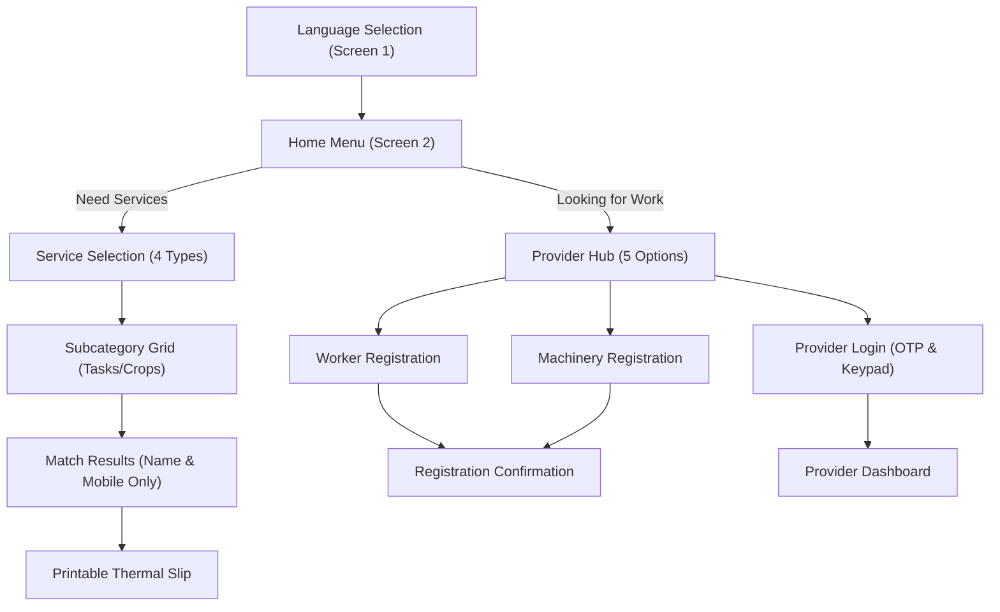

# GramaConnect — Comprehensive UI/UX Audit (Phase 0)

> **Document Status**: Complete Phase 0 Audit  
> **Target Audience**: Jury & Evaluators on Large Displays / Projectors (1920×1080, 1366×768, 1280×720 at 125% zoom)  
> **Core Principle**: **UI ONLY** — 100% preservation of all business logic, matching algorithms, authentication/OTP, daily availability expiration, speech synthesis, receipt formatting, and test invariants.

---

## 1. Where Styles Live & Design Token Architecture

### 1.1 Style File Hierarchy
| File Path | Role & Content | Specific Notes |
| :--- | :--- | :--- |
| `src/App.css` | **Primary Monolithic Stylesheet** (5,246 lines) | Holds 98% of all styles: `:root` CSS variables, typography, layout wrappers, headers, all component screens, animations, responsive breakpoints, and `@media print`. |
| `src/index.css` | **Base Document Reset** (30 lines) | Minimal root font smoothing and background reset. |
| `src/assets/illustrations.tsx` | **Inline Vector Artwork Components** | Contains pure SVG JSX icons and illustrations with inline fill and stroke colors. |
| `src/components/AgriculturalHeroBanner.tsx` | **Banner Illustration** | Self-contained 1600×440 responsive SVG with layered gradients and defs. |
| `src/components/GrowingGrassStrip.tsx` | **Plant Progress Visualizer** | Multi-element inline SVG with dynamic stage classes. |
| `src/components/ProviderLogin.tsx` | **Welcome Panel SVG Artwork** | Embedded morning farm illustration with inline radial and linear gradients. |

### 1.2 Current Design Variables (`src/App.css` `:root`)
- **Current Palette**: Contains 13 core variables (`--color-navy-blue: #12304A`, `--color-agri-blue: #1557A6`, `--color-vibrant-blue: #2677D8`, `--color-sky-blue-accent: #43B8E8`, `--color-pale-sky: #EAF6FF`, `--color-fresh-leaf: #279653`, `--color-deep-crop: #176B45`, `--color-soft-leaf: #E1F3E5`, `--color-harvest-gold: #F3C969`, `--color-warm-cream: #FFF7E8`, `--color-main-text: #183247`, `--color-secondary-text: #526779`, `--color-pure-white: #FFFFFF`).
- **Critical Test Invariants (MUST NOT BE REMOVED)**:
  - `--color-primary: #1e40af;` (checked by `test-verification.ts` line 932)
  - `--color-primary-light: #eff6ff;`
  - `--color-primary-border: #bfdbfe;`
  - `--color-sky-blue: #0284c7;` (checked by `test-verification.ts` line 1059)
  - `--color-leaf-green: #16a34a;`
  - `--color-warm-offwhite: #f8fafc;`
- **Missing Earth & Category Tokens (To add in Phase 1)**:
  - Soil brown: `#8A5A3A`, Deep soil: `#3B2A1E`, Clay red: `#C8553D`, Turmeric: `#E8A91C`, Paddy tint: `#F2F7E4`.
  - Category variables:
    - Worker: `--cat-worker: #279653;` (Leaf Green)
    - Tractor: `--cat-tractor: #C8553D;` (Clay Red)
    - Harvester: `--cat-harvester: #E8A91C;` (Turmeric)
    - Mini-Truck: `--cat-truck: #1557A6;` (Deep / Sky Blue)
    - Other Machinery / Implements: `--cat-machinery: #8A5A3A;` (Soil Brown)

---

## 2. Screen & Component Inventory

| Screen Name / State | File / Component | Primary Purpose & Key Workflows |
| :--- | :--- | :--- |
| **Welcome & Language Selection** | `src/components/LanguageSelection.tsx` (`LANGUAGE_SELECT`) | Trilingual portal (English, తెలుగు, हिन्दी) with audio welcome and 1-tap/numeric selection (`1`, `2`, `3`). |
| **Agricultural Hero Banner** | `src/components/AgriculturalHeroBanner.tsx` (Shared) | Connected village network scene with central hub, digital threads, and farm machinery. |
| **Header & Sub-Navigation** | `src/components/Header.tsx` (Persistent Shell) | Branding, audio replay, voice guidance mute, 300s session timer, Provider Login trigger, Back & Home buttons, Rampur Gram Panchayat badge. |
| **Home Menu** | `src/components/HomeMenu.tsx` (`HOME_MENU`) | High-level bifurcation: `LOOKING_FOR_WORK` vs `NEED_SERVICES` with 2-tap audio selection flow. |
| **Service Category Selection** | `src/components/ServiceSelection.tsx` (`SERVICE_SELECT`) | 4 core categories: Person/Workers, Tractor, Harvester, Mini-Truck. |
| **Work Subcategory Grid** | `src/components/SubcategoryGrid.tsx` (`SUBCATEGORY_SELECT`) | Deep agricultural task selection (e.g. Sowing, Weeding, Rotavator, Paddy Combine) with keyboard 1–9 and 2-tap audio confirmation. |
| **Registration Hub** | `src/components/ProviderHub.tsx` (`PROVIDER_HUB`) | Gateway for workers, tractors, harvesters, trucks, and existing provider account login. |
| **Worker Registration Form** | `src/components/WorkerRegistration.tsx` (`WORKER_REGISTER`) | Mandatory name, 10-digit mobile, skill multi-selection, village selection, consent declaration. |
| **Machinery Registration Form** | `src/components/MachineryRegistration.tsx` (`TRACTOR_REGISTER`, etc.) | Machinery model, single active attachment, daily availability confirmation, vehicle photo uploader. |
| **Vehicle Photo Uploader** | `src/components/VehiclePhotoUploader.tsx` (Sub-component) | Drag-and-drop dropzone or preset photo selector for machinery listings. |
| **Provider Login Portal** | `src/components/ProviderLogin.tsx` (`PROVIDER_LOGIN`) | Mobile number entry with on-screen numeric keypad, OTP verification, demo accounts. |
| **Provider Dashboard** | `src/components/ProviderDashboard.tsx` (`PROVIDER_DASHBOARD`) | Live daily availability toggle, tractor single-attachment switcher, worker skills management, profile editing. |
| **Search Results & Matches** | `src/components/MatchResults.tsx` (`MATCH_RESULTS`) | Continuous list displaying strictly Name & Mobile, Print All Contacts button, empty match state. |
| **Registration Confirmation** | `src/components/RegistrationConfirmation.tsx` (`REGISTRATION_CONFIRMATION`) | Success badge, reference number, registration summary, return home button. |
| **Growing Plant Progress Strip** | `src/components/GrowingGrassStrip.tsx` (Bottom Shell) | 5-stage developing paddy crop synchronized with user workflow. |
| **Printable Receipt Slip** | `src/components/PrintableReceipt.tsx` (Modal / Print View) | Strict thermal receipt layout rendering strictly Name and Mobile number. |
| **Session Inactivity Modal** | `src/components/IdleWarningModal.tsx` (Shell Overlay) | 30-second countdown prompt before automatic session reset. |

---

## 3. Screen-by-Screen Changes & Risk Assessment



### 3.1 Detailed Screen Breakdown

#### A. Welcome & Language Selection (`LanguageSelection.tsx`)
- **CSS Classes to Update**: `.welcome-location-badge`, `.language-cards-container`, `.lang-card`, `.lang-native-title`, `.lang-sub-title`, `.card-cultural-icon`, `.lang-card-active`.
- **Target Changes**:
  - Restyle language cards into seed-packet style tiles with category color accents and inline SVG motifs (paddy, marigold, mango leaf) instead of emojis.
  - Projector-ready typography (native script at 36px+, subtitle at 18px+).
  - Clear checkmark on active selection.
- **Risks & Invariants**:
  - Keep keyboard shortcuts (`1`, `2`, `3`) via `useKeyboardNav`.
  - Do not change speech announcement texts (`speakText`).

#### B. Header & Sub-Navigation (`Header.tsx`)
- **CSS Classes to Update**: `.kiosk-header`, `.header-top-row`, `.brand-group`, `.brand-badge`, `.header-controls`, `.replay-voice-btn`, `.voice-toggle-btn`, `.timer-badge`, `.kiosk-tool-btn`, `.header-nav-row`, `.nav-action-btn`.
- **Target Changes**:
  - Transform header into a warm sky-gradient band with an organic hill silhouette on its bottom edge.
  - Logo badge: Replace square with a fresh green sprout medallion and title-case "GramaConnect".
  - Standardize all utility buttons to uniform 52px rounded pills.
  - Present session countdown in a high-contrast circular timer badge.
  - Replace heavy black borders with 2px mid-tone earthy borders.
- **Risks & Invariants**:
  - **CRITICAL**: The header must NEVER contain a language dropdown or language selector (`!headerSource.includes('className="lang-switcher"')`).
  - Do not alter `secondsRemaining`, `onResetSession`, or `replaySpeech` handlers.

#### C. Plant Progress Strip (`GrowingGrassStrip.tsx`)
- **CSS Classes to Update**: `.growing-grass-container`, `.single-plant-pod`, `.grass-artwork-wrapper`, `.grass-svg`, `.soil-bed-path`, `.plant-stage-group`, `.flourishing-harvest-group`.
- **Target Changes**:
  - **Relocate from floating pill to docked full-width bottom field strip** (64px height, warm soil-brown base `#3B2A1E` / `#8A5A3A`).
  - Add `padding-bottom: 84px` to `.kiosk-main-content` so content is never occluded.
  - Retain plant SVG artwork and smooth 5-stage growth.
- **Risks & Invariants**:
  - **CRITICAL**: Must preserve CSS selectors `.growing-grass-container`, `.grass-svg`, `.soil-bed-path`, `.flourishing-harvest-group`, and `@keyframes grass-breeze-left` for test verification.
  - Must remain completely hidden in `@media print`.

#### D. Home Menu (`HomeMenu.tsx`)
- **CSS Classes to Update**: `.kiosk-menu-grid`, `.kiosk-menu-card`, `.card-number-badge`, `.card-illustration-wrap`, `.card-details`, `.card-main-title`, `.selected-highlight`.
- **Target Changes**:
  - Convert 2 main choice cards into high-contrast village signboard cards with two-tone coloured illustration medallions.
  - Remove all-caps yelling titles; use title case.
  - Remove `[ KEY 1 ]` / `[ KEY 2 ]` pill styling; use clean numbered circular badges.
- **Risks & Invariants**:
  - Must preserve exact two-tap logic (`first tap = voice audio + highlight`, `second tap = navigate`).
  - Must preserve keyboard shortcuts `'1'` and `'2'`.

#### E. Service Selection & Subcategory Grid (`ServiceSelection.tsx`, `SubcategoryGrid.tsx`)
- **CSS Classes to Update**: `.services-grid-4`, `.service-card`, `.subcategories-grid`, `.subcat-card`, `.subcat-title-primary`, `.subcat-desc`.
- **Target Changes**:
  - Seed-packet card style: Coloured category top band (Worker = leaf green, Tractor = clay red, Harvester = turmeric, Truck = sky/deep blue).
  - Round medallions with two-tone coloured SVG icons instead of flat black silhouettes.
  - Enhanced first-tap visual state: Elevated card, 3px category-color border, subtle warm glow, speaker icon with localized "Tap again to open".
  - Responsive grid: 4 columns at 1920px, 3 at 1366px, 2 at mobile/narrow.
- **Risks & Invariants**:
  - Must preserve two-tap selection and audio announcements on every single item.
  - Key navigation (1–9) must remain intact.

#### F. Provider Hub (`ProviderHub.tsx`)
- **CSS Classes to Update**: `.provider-hub-grid`, `.provider-option-card`, `.option-badge`, `.option-title`, `.option-desc`.
- **Target Changes**:
  - Replace tall, mostly empty vertical cards with a balanced 2-column horizontal grid.
  - Left side: Large round illustration medallion in category color; Right side: Title, 1-line friendly description, arrow button.
  - Convert shouting badges (`[ MANDATORY DETAILS ]`, `[ DAILY REGISTRATION ]`) into friendly step chips.
- **Risks & Invariants**:
  - Keep 5 distinct action destinations (`REGISTER_WORKER`, `REGISTER_TRACTOR`, `REGISTER_HARVESTER`, `REGISTER_MINI_TRUCK`, `PROVIDER_LOGIN`).

#### G. Registration Forms (`WorkerRegistration.tsx`, `MachineryRegistration.tsx`, `VehiclePhotoUploader.tsx`)
- **CSS Classes to Update**: `.registration-form-container`, `.kiosk-input`, `.kiosk-form-group`, `.skill-chips-group`, `.consent-checkbox-card`, `.vehicle-photo-uploader-container`.
- **Target Changes**:
  - 56px large inputs with 2px borders and clear focus rings in sky/deep blue.
  - Inline error messages in clay red `#C8553D` with alert icons.
  - Chips: Selected = solid crop green `#176B45` with WHITE text and check icon; Unselected = white with green border and dark text.
  - Earth-brown dashed dropzone for photo uploader with consistent preview aspect ratio.
- **Risks & Invariants**:
  - **CRITICAL**: Compulsory name & 10-digit mobile number validation must never be bypassed.
  - Daily tractor activation logic and midnight expiry rules must not be altered.
  - Photo uploader must never inject photos into printed slips.

#### H. Provider Login Portal (`ProviderLogin.tsx`)
- **CSS Classes to Update**: `.provider-login-split-grid`, `.provider-login-welcome-panel`, `.welcome-farm-artwork`, `.provider-login-card`, `.kiosk-touch-keypad`, `.keypad-key`.
- **Target Changes**:
  - Two-column balanced desktop layout for large screens/projectors.
  - Left panel: Village morning scene + friendly benefit rows with soft green icons.
  - Right panel: Cream card, clean IN +91 field, proportional keypad with distinct clear/delete buttons.
  - Professional "Demo Mode" ribbon.
- **Risks & Invariants**:
  - OTP generation and verification endpoints (`/api/auth/send-otp`, `/api/auth/verify-otp`) must remain 100% untouched.

#### I. Provider Dashboard (`ProviderDashboard.tsx`)
- **CSS Classes to Update**: `.dashboard-profile-header`, `.profile-avatar-circle`, `.provider-tab-btn`, `.skill-chip-btn`, `.daily-validity-card`, `.status-toggle-controls`.
- **Target Changes**:
  - Avatar medallion with provider's initials or sprout icon (no empty user circles).
  - Status panel: Active = bright green panel with sun icon; Inactive = soil-grey panel with moon icon.
  - **CRITICAL FIX**: Category switcher & skill chips: Unreadable white-on-white text fixed to solid crop green with crisp white text.
- **Risks & Invariants**:
  - Status toggle (`handleToggleStatus`), tractor attachment switch (`handleSelectAttachment`), and daily renewal (`handleActivateTractorToday`) must not be altered.

#### J. Search Results & Thermal Slip (`MatchResults.tsx`, `PrintableReceipt.tsx`)
- **CSS Classes to Update**: `.match-results-container`, `.continuous-provider-list`, `.provider-row-item`, `.receipt-modal-container`.
- **Target Changes**:
  - Crisp continuous rows with category accent markers.
  - Legible typography (Name 22px+, Phone 18px+).
  - Empty state with friendly rural illustration and retry suggestion.
- **Risks & Invariants**:
  - **CRITICAL TEST INVARIANT**: Absolutely NO wages, rates, or `₹` symbols anywhere in `MatchResults`.
  - Public results must display strictly Name and Mobile number.
  - `PrintableReceipt` and print media styles must remain untouched.

---

## 4. Known Visual Bugs & Planned Fixes

| Bug ID | Description of Problem | Location | Planned Fix |
| :--- | :--- | :--- | :--- |
| **BUG-1** | **Floating Plant-Progress Pill**: Floats at `bottom: 12px; right: 20px`, covering buttons, inputs, and text across screens. | `GrowingGrassStrip.tsx`, `App.css` | Dock as a 64px full-width field strip at the viewport bottom with soil-brown base; add `padding-bottom: 84px` to main content. |
| **BUG-2** | **Unreadable Selected Chip Text**: Selected "Farm Labour" or skill chips have light-on-light text, unreadable on projectors. | `ProviderDashboard.tsx`, `App.css` (`.skill-chip-btn.selected`, `.provider-tab-btn.active`) | Explicitly style selected state with solid crop green `#176B45`, 100% white text `#FFFFFF`, and checkmark. |
| **BUG-3** | **Boxed Hero Banner with Empty Sides**: Banner is framed in a small container with awkward white margins. | `AgriculturalHeroBanner.tsx`, `App.css` | Make banner full-width inside the kiosk container with dedicated copy panel above and full-bleed landscape below. |
| **BUG-4** | **Oversized Empty Registration Cards**: Registry options are tall, mostly empty vertical tiles with harsh shouting caps. | `ProviderHub.tsx`, `App.css` | Restyle into compact 2-column horizontal cards with category medallions and friendly step chips. |
| **BUG-5** | **Empty Avatar Circle**: Dashboard displays a generic faint silhouette in an empty circle. | `ProviderDashboard.tsx`, `App.css` | Populate avatar medallion with provider's uppercase name initial or sprout icon in category badge. |

---

## 5. Safe Order of Work (Phased Execution Plan)

```
Phase 0: UI Audit Only (Current Step — Complete)
   ↓
Phase 1: Design System Foundation (CSS variables, @fontsource fonts, shared base elements, earth background)
   ↓
Phase 2: App Shell (Header, sub-navigation, docked bottom field strip, 250ms page transitions)
   ↓
Phase 3: Welcome Screen, Language Tiles & Banner (Full-width banner, native script tiles, HomeMenu cards)
   ↓
Phase 4: Service & Work Category Selection (Seed-packet cards, 2-tap visual states, 4/3/2 responsive grid)
   ↓
Phase 5: Registry Hub & Registration Forms (2-column horizontal hub cards, 56px inputs, solid chips)
   ↓
Phase 6: Provider Login Portal (Two-column layout, village morning artwork, proportional keypad)
   ↓
Phase 7: Provider Dashboard (Avatar initials, sun/moon status panel, high-contrast skill chips)
   ↓
Phase 8: Remaining Screens & Final Visual QA (Search results, empty states, 1920/1366/1280 test, 147 test assertions)
```

### Safety & Verification Protocol for Every Phase
1. **Zero Code Regression**: After every phase, run:
   ```bash
   cmd /c "npm run build"
   cmd /c "npx tsx test-verification.ts"
   ```
2. **Commit Policy**: Commit after each successful phase (`git commit -m "feat(ui): phase X complete"`).
3. **Rollback Ready**: If any logic breaks or test fails, immediately `git checkout -- .` and diagnose before proceeding.
4. **Projector Verification**: Inspect all screens at 1920×1080, 1366×768, and 125% browser zoom.

---
*End of Phase 0 Audit Artifact. Ready for User Review.*
